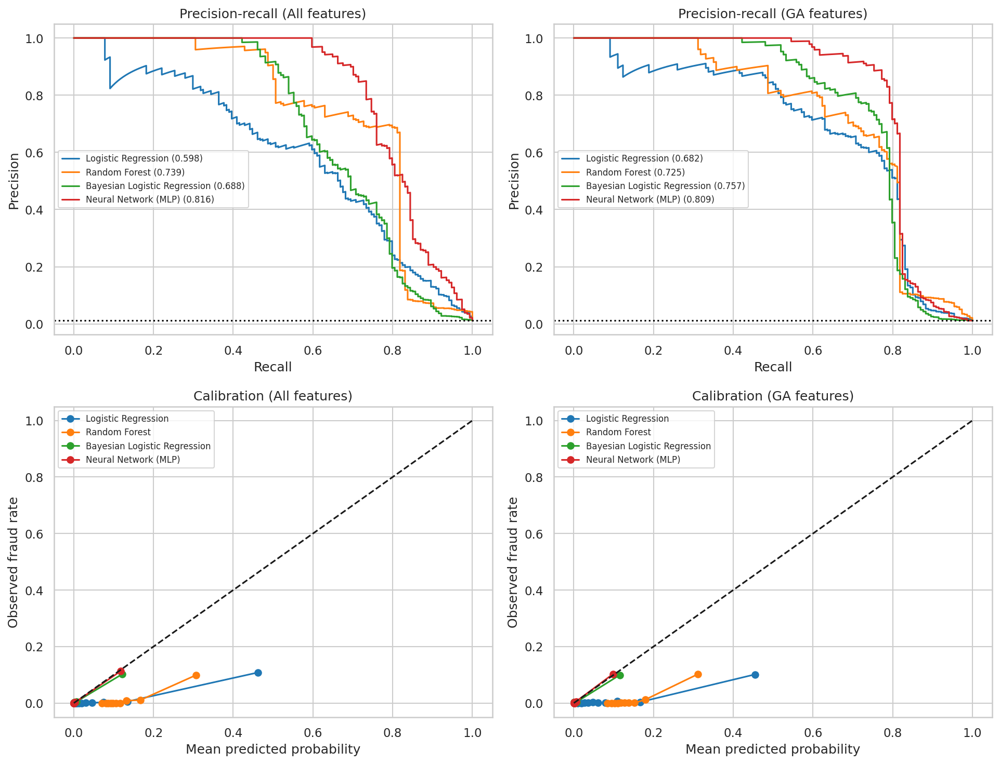

# Healthcare Insurance Fraud Detection: Bayesian Logistic Regression, Neural Networks and Genetic-Algorithm Feature Selection

**Abstract.** Healthcare claims are heavily imbalanced (about 2% fraud), so fraud models must rank claims well and
report how sure they are. This project extends Al-Ghazi et al. (ICITRI 2024), who compared Logistic Regression
and Random Forest, by adding Bayesian Logistic Regression, a neural network (MLP) and Genetic-Algorithm feature
selection, evaluated on a synthetic claims dataset with provider-grouped splits. The MLP ranked fraud best
(PR-AUC 0.82 vs 0.60-0.74 for the paper-style baselines), Bayesian LR gave well-calibrated probabilities with
per-claim uncertainty, and GA selection matched full-feature performance with 23-45% fewer features.

## Data
Synthetic claims, patients and providers from
[quailrobot/health-claims-v1-sample](https://huggingface.co/datasets/quailrobot/health-claims-v1-sample):
65,190 claims, 1,500 providers, 2.3% fraudulent claims.

## Methodology
- Split by **provider** (train/validation/test), so no provider appears in two splits.
- 73 engineered features (billing vs peers, repeated claims, provider behaviour), Robust Scaler fitted on training data.
- Models:

Logistic regression: $p(\text{fraud}\mid x)=\sigma(\beta_0+\beta^\top x)$

Random forest: $\hat p(x)=\frac1T\sum_{t=1}^{T}p_t(x)$

Bayesian logistic regression: $p(w\mid D)\approx\mathcal N(w_{MAP},H^{-1})$, $\;p(\text{fraud}\mid x)\approx\frac1S\sum_s\sigma(w_s^\top x)$

Neural network: $h_1=\text{ReLU}(W_1x+b_1),\ h_2=\text{ReLU}(W_2h_1+b_2),\ p=\sigma(w_3^\top h_2+b_3)$

Genetic algorithm: $\text{fitness}(m)=\text{PR-AUC}_{val}(m)-0.02\cdot\frac{\sum_j m_j}{73}$

- Evaluation: PR-AUC (main), ROC-AUC, F1, recall, Brier score, calibration (ECE), bootstrap over providers with Holm correction.

## Key findings
- MLP: PR-AUC 0.82 (main split), mean 0.73 over five other splits; significantly better than Logistic Regression and Bayesian LR with all features after Holm correction (not significantly better than Random Forest).
- Paper-style baselines without class weights improve to 0.72 (LR) and 0.78 (RF) PR-AUC.
- Bayesian LR is the best-calibrated interpretable model (ECE 0.002) and uncertainty flags its errors.
- GA reduced features by 23-45%; no significant PR-AUC change after correction.
- The paper’s “reimbursed amount matters most” finding was not confirmed: for Bayesian LR, billing relative to peers ranked first, while the other models relied more on provider size and claim counts.

## Reproduce
1. Open the notebook with the Colab badge above (or `pip install -r requirements.txt` locally).
2. Run all cells in order (about 25 minutes in fast mode).
3. Figures and tables are written to `docs/figures/`.

## Repository layout
`notebooks/` analysis notebook · `src/` reusable code · `data/` small sample · `docs/` report, slides, figures

## Limitations
Synthetic data (one month, 52 fraud providers, 10 in the test split); provider labels derived from claim labels;
single-threshold metrics are unstable; referral-ring fraud is not detectable from claim-level features.

## Reference
Al-Ghazi et al., *Classification of Health Insurance Fraud Risk with Machine Learning*, ICITRI 2024.
https://ieeexplore.ieee.org/document/10699052
